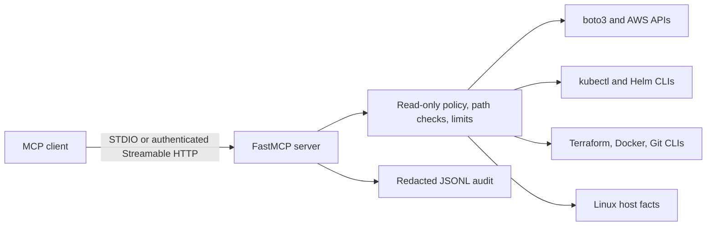

# Architecture and supported scope

CosmoTech Infrastructure MCP is a Python 3.12+ MCP server built with FastMCP. It exposes 25 tools (19 infrastructure readers and 6 company tools; mission execution writes a local journal) using two transports:

- **STDIO:** a local MCP client starts `python -m cosmotech_mcp serve --transport stdio`; the server reads/writes MCP protocol messages over stdin/stdout.
- **Streamable HTTP:** the server listens on `MCP_HTTP_HOST:MCP_HTTP_PORT` and exposes `/mcp`. It requires a static bearer token. The default bind address is loopback.

## Integrations

- AWS is accessed directly through boto3's standard credential provider chain. Identity uses STS; inventory supports EKS, ECR, EC2, SQS, DynamoDB, and IAM. AWS inventory sections are limited to 200 resources.
- Kubernetes operations invoke the local `kubectl` executable and its active context. Health, namespace-wide resources, and observability checks can require cluster-wide read permissions. `helm_inventory` reads Helm releases through the local Helm CLI.
- Terraform commands are external CLI calls. The server does not initialize configurations, persist plans, refresh state, apply, or destroy.
- Docker inspection and Git status use the local CLI. Linux host facts are read directly from the running Python process environment.

## Limits and future scope

- Native Azure and GCP SDK integrations, OpenShift-specific APIs, provider-native policy evaluation, and infrastructure write operations are not implemented. Company diagnostic orchestration is documented in [company-agent.md](company-agent.md).
- Kubernetes can work with EKS, AKS, GKE, or OpenShift when a compatible Kubernetes context exists; those are not native provider adapters. Only the EKS context noted in the validation record has been exercised.
- `observability_health` checks pod phase and container readiness for names/namespaces matching Prometheus, Grafana, Loki, Tempo, and OpenTelemetry Collector. It does not call their product APIs or query metrics/logs/traces.
- The Docker image includes the Python server only, not the provider CLIs. Container users must configure the tools and credentials they need separately.
- Hosted-client OAuth, per-user authorization, and multi-tenant isolation are not implemented. Static HTTP bearer authentication is suitable only for controlled environments.

## Execution controls

The server uses a read-only command allowlist, argument arrays with `shell=False`, explicit working-directory roots, bounded command runtime and output, redaction, and audit logging. Tool errors return a structured error; an unavailable audit log prevents tool execution. See [security](security.md) for details and [examples](examples.md) for each tool's parameters.
