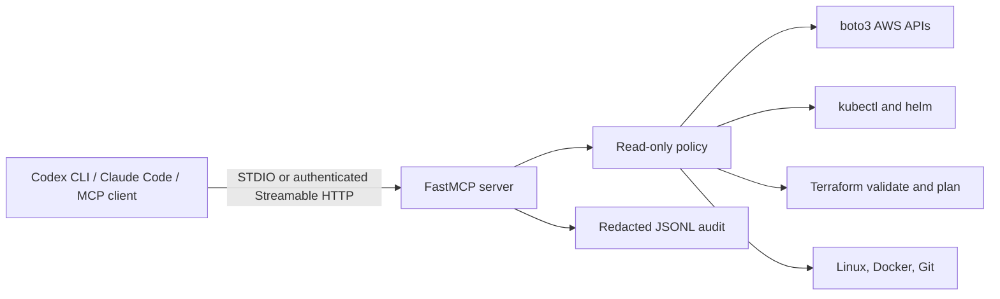

# MVP architecture and controls

## Boundaries

- The provider-independent tool server depends on provider adapters, configuration, a read-only policy, command execution, redaction, and audit.
- AWS provider operations are direct boto3 reads. Kubernetes support is CLI-context based, so the same tools work with any cluster supported by the user's `kubectl` context and installed plugins.
- Azure and GCP SDK adapters, OpenShift API-specific checks, and Linux agents are not implemented in this MVP.
- STDIO inherits the local user's process permissions. HTTP requires a configured static bearer token and uses loopback by default. Remote production use should replace the static token with enterprise OAuth/OIDC and TLS termination.
- Commands have no shell, an allowlist, bounded runtime, bounded captured output, and configured working-directory roots.
- Audit events contain arguments after redaction, tool name, timestamp, outcome, and exception type. Tool results are not written to the audit file.
- The Terraform plan tool disables refresh and locking, does not persist the plan, and does not initialize. It may still evaluate supported providers; use a local backend/state and a test workspace when reviewing plans.
